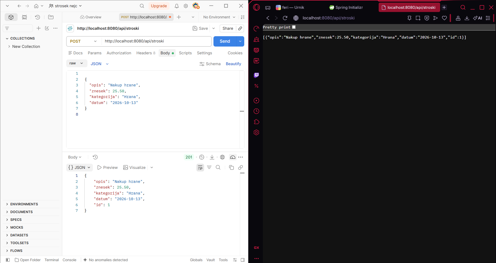
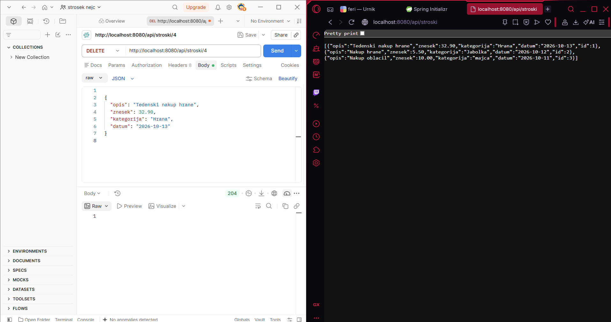
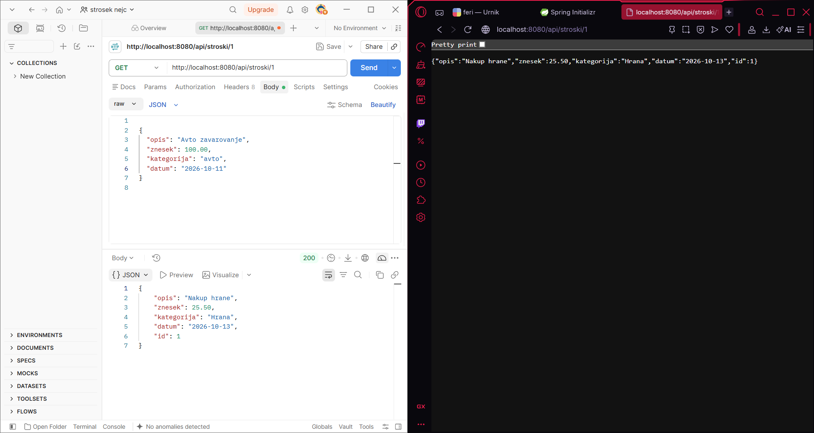
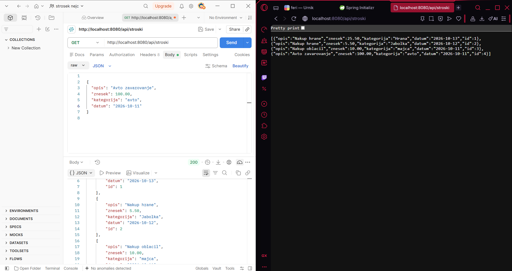
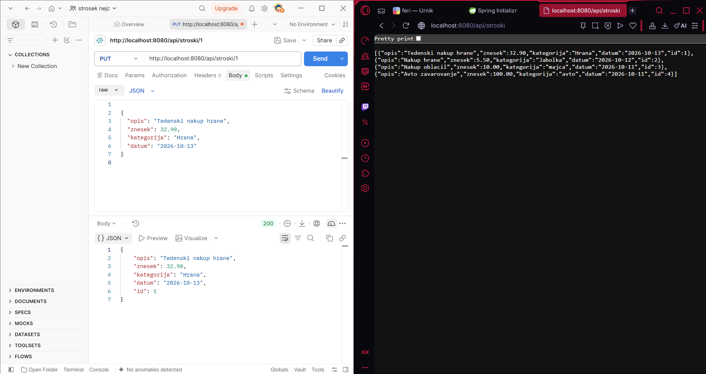

Ideja projekta je razvoj spletne aplikacije za spremljanje osebnih stroškov. Uporabnik bo lahko beležil svoje vsakodnevne izdatke, jih pregledoval, urejal in brisal. Vsak strošek bo vseboval opis, znesek, kategorijo in datum. Stroške bo mogoče razvrščati po kategorijah, na primer hrana, prevoz, zabava in položnice. Aplikacija bo uporabniku omogočala boljši pregled nad tem, za kaj porabi največ denarja, ter mu pomagala pri načrtovanju osebnega proračuna. V prihodnosti bo mogoče dodati tudi prikaz skupnih mesečnih stroškov in primerjavo porabe med posameznimi meseci.

V prvi fazi bo razvit backend sistem, ki bo omogočal dodajanje, prikazovanje, posodabljanje in brisanje stroškov. Podatki se bodo shranjevali v podatkovno bazo, delovanje sistema pa bo preverjeno s testiranjem posameznih funkcionalnosti.

